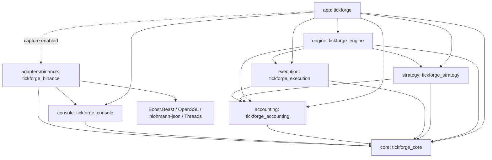
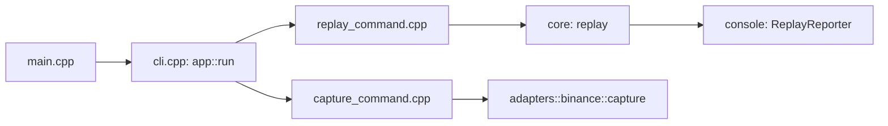
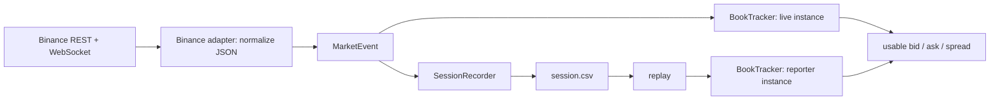

# Code map

The filesystem follows the production CMake targets. Each target owns a directory
and its own `CMakeLists.txt`; the root only selects options, compiler requirements,
source subdirectories, and tests. Header include paths identify their owner, for
example `<tickforge/core/events.hpp>`.

```text
tickforge/
  CMakeLists.txt                    project options and subdirectories
  CMakePresets.json                 shared Windows / Linux / WSL build profiles
  cmake/ProjectOptions.cmake        compiler capability check and warnings helper
  third_party/
    tomlplusplus/                  INTERFACE target tomlplusplus: vendored toml++ v3.4.0 header (MIT)
  src/
    CMakeLists.txt                  component build order
    core/                          library: tickforge_core
      CMakeLists.txt
      include/tickforge/core/       public domain/session headers
      src/                         implementations
    accounting/                    library: tickforge_accounting (balances/reserves/PnL)
      CMakeLists.txt
      include/tickforge/accounting/
      src/
    execution/                     library: tickforge_execution (simulation/orders)
      CMakeLists.txt
      include/tickforge/execution/
      src/
    strategy/                      library: tickforge_strategy (decision policies)
      CMakeLists.txt
      include/tickforge/strategy/   Strategy interface and actions, View, shared rules, ThresholdConfig
      src/                         rules, threshold, threshold_maker, mean_reversion policies
    engine/                        library: tickforge_engine (the shared per-event loop)
      CMakeLists.txt
      include/tickforge/engine/     Session, SessionConfig, SessionObserver, Mark
      src/
    console/                       library: tickforge_console
      CMakeLists.txt
      include/tickforge/console/    public presentation headers
      src/                         formatting and replay reporting
    adapters/                      venue adapters, each owning its target
      CMakeLists.txt
      binance/                     optional library: tickforge_binance
        CMakeLists.txt
        include/tickforge/adapters/binance/
        src/                       Binance JSON and TLS/WebSocket implementation
    app/                           executable: tickforge
      CMakeLists.txt
      main.cpp                     entry point
      cli.cpp, cli.hpp             argument dispatch, usage, and exit codes
      commands.hpp                 command declarations
      replay_command.cpp           replay command
      capture_command.cpp          capture command / disabled-feature error
      paper_command.cpp            offline paper trading command: replay -> engine
      live_command.cpp             forward paper trading: live feed (+ recording) -> engine
      live_dashboard.*             full-screen live view; forwards callbacks to the journal
      paper_journal.*              journal observer: console lines, totals, markouts, reports
      paper_scenario.*             TOML experiment config, overrides, schema checks
      paper_reporter.*             virtual-order/account journal
      paper_export.*               machine-readable order/fill/markout/summary CSV reports
      paper_diagnostics.*          fill evidence counts and post-fill markouts (report-only)
  tests/
    CMakeLists.txt
    core/                          session, synchronization, and book contracts
    accounting/                    ledger, PnL valuation, and checked money arithmetic
    execution/                     fills, virtual liquidity, and risk
    strategy/                      decisions and confirmed-inventory behavior
    engine/                        loop order, determinism, scripted orders
    console/                       exact decimal display
    adapters/binance/              Binance-shaped JSON (no network)
    app/                           CLI integration checks
```

Public headers describe how another target can use a component. Implementations
live under that component's `src/`. The executable's private headers stay beside
its implementation because no other target consumes them. Test groups also have
local `CMakeLists.txt` files and link only the component they exercise.

## Build dependencies

An arrow means **uses / links to**, not event flow:



- `core` uses the C++ standard library only. It has no terminal or network dependency.
- `console` publicly depends on `core` because its public functions/classes use core
  types such as `OrderBook` and `BookTracker`.
- `accounting` publicly depends on core order/fill types. It does not depend on an
  execution implementation or a venue. `execution` depends on accounting and core;
  only the app assembles it with presentation and a replay/scenario.
- `adapters/binance` publicly depends on `core` because its normalization API returns core
  events. It privately depends on `console` for capture diagnostics and on external
  libraries for its implementation. It does not expose JSON/Boost/OpenSSL types.
- `app` privately links the components it calls. Its capture feature switch is
  contained in `capture_command.cpp`.

In CMake, `PUBLIC` makes usage requirements available to consumers as well as the
target itself. `PRIVATE` keeps compile-time usage requirements within the target.
Static libraries can still require their private dependencies at final link time;
CMake carries that link requirement automatically.

## Core files

| Header / implementation | Responsibility |
| --- | --- |
| `events.hpp` | Shared vocabulary: times, trades, levels, snapshots, depth ranges, and local resets. `MarketEvent` holds one of these payloads. |
| `orders.hpp` / `amounts.hpp` / `amounts.cpp` | Shared order (market/limit), fill (taker/maker), and execution-report types, and checked integer monetary arithmetic. |
| `order_book.hpp` / `.cpp` | Known price levels in ordered maps, absolute-size updates, best bid/ask, spread, and range validation. |
| `book_tracker.hpp` / `.cpp` | Decides when the book may be exposed. Buffers depth around REST snapshots, establishes a stream bridge, and hides quotes after resets/gaps. |
| `recorder.hpp` / `.cpp` | Creates a new recording exclusively, writes normalized events in order, flushes them, and marks successful completion with a footer. |
| `replay.hpp` / `.cpp` | Reads and validates v1-v4 sessions; invokes a callback once per event in recorded order. No sleeping or network access. |
| `units.hpp` / `.cpp` | Exact parsing of human-readable prices, BTC/USDT amounts, percentages, and durations into integer atoms. No floating point and no silent rounding. |

`OrderBook` answers **what levels are known?** `BookTracker` answers **can consumers
use those levels now?** This distinction prevents a REST snapshot from looking
usable before its relationship to the live stream has been verified.

## Venue adapter files

Each venue owns a target, include path, and namespace. Binance uses
`tickforge_binance`, `<tickforge/adapters/binance/...>`, and
`tickforge::adapters::binance`. This keeps venue-specific parsers from colliding
when another exchange is added. `TICKFORGE_ENABLE_LIVE` remains the existing build
option for public network capture; it is not a target or an abstract source API.

Replay remains in `core` as session-file I/O. Network adapters and replay produce
the same `MarketEvent` types; a common virtual source interface is not implemented.

`binance_protocol.hpp/.cpp` translates Binance JSON into shared events and checks
decimal precision, tick/quantity steps, symbols, IDs, and timestamps. It contains
no sockets, making its inputs easy to test with synthetic JSON.

`live_feed.hpp` declares `run_feed`: the public stream as pushed market events, each
recorded first (optionally) and then handed to a caller's handler, plus status notes.
`capture.hpp` declares `capture`, which is `run_feed` with recording, a once-per-second
book view, and a no-op handler. Both are implemented in `live_feed.cpp`: its private
`HttpsGet` handles REST transport, `StreamSocket` handles the combined depth/trade
WebSocket, and `Feed` coordinates metadata, recording, book tracking, timers, signals,
and recovery. There is one application event loop.

## Console and application files

`console.hpp/.cpp` contains reusable exact decimal formatting, book/status text,
and checked console writes. `replay_reporter.hpp/.cpp` prints an event, updates its
`BookTracker`, counts event types/warnings, and prints the final replay summary.
Its per-event overloads make the handling of each payload explicit.

The application call chain is deliberately small:



`main.cpp` delegates. `cli.cpp` checks command shape and duration, shows usage,
dispatches, and maps failures to exit codes. `replay_command.cpp` opens the file
and connects `replay` to `ReplayReporter`. `capture_command.cpp` calls the optional
adapter, or reports that capture was not enabled in this build.

## Data flow

Capture and replay use the same event types and the same book-tracking code, but
they have separate instances of the state:



A reset makes quotes unavailable. During startup, depth can arrive before the REST
snapshot: it is recorded and buffered. Once a snapshot and a bridging range agree,
quotes become usable. On replay the same recorded order reconstructs those same
availability transitions without needing future data.

## Market data versus order execution

A market-data adapter receives prices, trades, and book changes. The current
Binance adapter only reads public depth and metadata. It has no account access.

An order-execution adapter would send orders/cancellations and consume order-status
and fill reports. It is a separate responsibility, not implemented here. The paper
command uses an asynchronous execution interface: orders are submitted, and their
confirmed results are reported later. The
first implementation is a local simulator, driven by scripted requests or the
offline strategy command. A real venue execution adapter would require an explicit
later stage, authentication, reconciliation, and handling uncertain request results.
Do not add real execution to the public market-data adapter implicitly.

## Paper trading components

`accounting/account.hpp/.cpp` owns total/reserved/available USDT and BTC, order
reservations, receipt deduplication, average cost basis, and realized PnL.
`accounting/valuation.hpp/.cpp` marks the position at a price: market value,
unrealized/total PnL, equity, and average cost. They are pure functions of the ledger.
`execution/execution.hpp` defines the asynchronous interface (`submit`, then
`take_reports` with execution and report times) and explicit paper settings.
`simulator.hpp/.cpp` consumes replay events, guards book freshness, delays execution
and reports by the configured latencies, simulates taker fills using separate virtual
liquidity counters, and keeps resting limit orders with an estimated queue position
that recorded trades and book changes advance. `risk.hpp/.cpp` (`RiskGuard`) tracks equity against loss,
drawdown, and order-rate limits and escalates normal -> reduce-only -> halted.
`order_manager.hpp/.cpp` asks the guard first, then performs order checks,
reserves funds, and submits or cancels; `collect()` later validates confirmed
reports (open ones carry partial fills) and commits them to the account.

`engine/session.hpp` is the loop every mode shares. `Session::on_event` takes one
pushed market event and runs simulator -> confirmed reports -> valuation -> risk ->
strategy -> orders; `submit`/`cancel` accept scripted requests between events and
`finish` ends the market data. It reads no clock: all time comes from event receive
offsets, so replaying a recorded session with the same config reproduces a run
exactly. It prints nothing; a `SessionObserver` receives market, report, request,
risk, signal, cancel, and notice callbacks, and the app's observers turn them into
the console journal, totals, markouts, and CSV reports.

Both market sources push events to a handler: `core::replay` from a file and
`adapters::binance::run_feed` from the live stream (recording each event first when
asked). `paper_command.cpp` feeds a recording to the engine; `live_command.cpp` feeds
the live stream to the same engine, with `live_dashboard.*` as the observer in a
terminal. `paper_journal.*` is the shared observer that prints the journal, counts
totals, measures markouts, and writes the reports for both.

The app's `paper_command.cpp` connects these pieces; `paper_scenario.*` reads the
TOML config (with `--set` overrides) into atoms using `core/units`,
experimental inputs, `paper_reporter.*` prints the operation journal, and
`paper_export.*` optionally writes the CSV reports. `paper_diagnostics.*` counts the
simulator's per-fill evidence (`execution::FillDiagnostic`: source, queue at entry,
level share, time since a data gap) and measures markouts from later trusted mids; it
lives in the app because it reads the future and must never feed a strategy. No new
network or console dependency is introduced into the ledger/execution libraries.
See [paper trading](paper-trading.md) for units, config syntax, assumptions,
example balances, PnL rules, and failure behavior.

`strategy/strategy.hpp` defines a decision interface returning actions (place,
cancel, notice) from a value snapshot of quotes, event time, availability, balances,
position, risk state, and open orders. The app fills the quotes from
`Simulator::executable_level`, which nets out virtual consumption. `rules.hpp/.cpp`
holds shared decision rules; `threshold.hpp/.cpp` (market orders),
`threshold_maker.hpp/.cpp` (resting limit orders), and `mean_reversion.hpp/.cpp`
(relative to a moving average, with a warm-up) implement the policies. A policy may
describe what it is waiting for through `status()`, which the live view shows. The
engine invokes the policy after each simulator update and risk check, and submits its
actions through OrderManager; `paper_command.cpp` builds the policy from the config.
`paper_scenario.*` validates either scripted `[[orders]]` or a `[strategy]` table.
See [strategies](strategies.md) for the event-flow diagram, input units, assumptions,
and a synthetic partial-buy/recovery/sell example. Strategy does not link execution,
console, or the Binance adapter; it cannot execute its own proposals.

## Working in stages

`AGENTS.md` records the project's layout and collaboration rules. Each completed
stage should finish with relevant checks, documentation updates, and a local Git
commit. Network access is not required for CTest. Publishing commits requires a
separate user request.

The executable remains at `build/tickforge` (or the existing configuration-specific
Windows output location), so the documented run commands do not change. After a
layout change, reconfigure CMake; it will discover the new target locations.
For IDE setup, preset selection, and GDB startup items, see
[Visual Studio + WSL](visual-studio-wsl.md).
