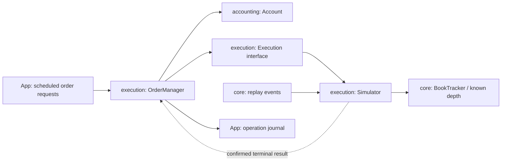

# Offline paper trading

This stage adds market-order simulation and a separate reusable account ledger.
It consumes existing replay sessions; it has no real order API, keys, or account
access. The separate [strategy command](strategies.md) generates automatic requests
through the same execution/accounting path. The ledger also keeps an average cost
basis and realized PnL; the report adds unrealized PnL at the last trusted bid.

## Run the complete example

From the repository root after building:

```sh
./build/tickforge paper examples/synthetic-book.csv examples/paper-orders.csv
```

Use the path of your actual build, such as `out/build/wsl-live-local/tickforge`.
The `paper` command works in both default and live-enabled builds, without network
dependencies or a network connection. For Visual Studio, set these arguments and
keep the repository root as the working directory:

```json
"args": ["paper", "examples/synthetic-book.csv", "examples/paper-orders.csv"]
```

The entirely synthetic example starts with 1000 USDT and no BTC. It submits eight
requests, demonstrates two partial buys, a sale across two bid levels, a rejected
request during a book gap, and trading after snapshot recovery. Expected results:

```text
Paper complete | 8 requests | 1 rejected | 8 fills | fees=0.78001350 USDT
  USDT    | total=609.20148650 | reserved=0.00000000 | available=609.20148650
  BTC     | total=0.00600000 | reserved=0.00000000 | available=0.00600000
  PNL     | cost basis=390.40093949 USDT | average cost=65066.83 USDT | realized=-0.39757401 USDT
  MARK    | bid 65000.00 USDT at event #8 (before exit fees and depth)
  VALUE   | BTC=390.00000000 USDT | equity=999.20148650 USDT
  TOTAL   | realized=-0.39757401 USDT | unrealized=-0.40093949 USDT | total=-0.79851350 USDT
```

The total is the change in equity: 999.20148650 - 1000 USDT. It is a result under
the stated execution assumptions, not evidence of a profitable method. Redirect
stdout to a local log if you want to save the human-readable operation journal.

## Component boundaries



- `tickforge_core` owns order/fill/result value types and checked integer arithmetic.
- `tickforge_accounting` owns the USDT/BTC ledger, order reservations, and applied
  receipt IDs. It depends only on core, not on the simulator, console, or a venue.
- `tickforge_execution` owns the execution interface, simulator, and order manager.
  It depends on accounting and core. The simulator itself does not change balances;
  the manager feeds confirmed fills into the ledger.
- The app reads a scenario, connects replay to the simulator, submits scheduled
  requests, and prints journal entries and final balances.

The account is a starting point for reuse with future real execution reports. It
currently models one base/quote pair, nonnegative balances, and USDT fees. Durable
ledger persistence, multi-asset fees, rebates, deposits/withdrawals, exchange-state
reconciliation, and asynchronous real execution are not implemented. The initial
`Execution` contract is synchronous and returns confirmed terminal results only.

## Scenario file v1

```text
tickforge-orders,1,BTCUSDT
account,initial_quote_atoms,initial_base_atoms[,initial_base_cost_quote_atoms]
config,fee_ppm,quantity_step_atoms,max_order_quantity_atoms,max_position_quantity_atoms,stale_after_ns
order,after_event_ordinal,order_id,buy_or_sell,quantity_atoms,max_spend_quote_atoms
```

The optional fourth `account` field is the total cost of the initial BTC in
1e-8 USDT. It is required when the account starts with BTC and must be absent or
zero otherwise, so inherited inventory never receives an implicit zero cost.
The first three rows are mandatory and ordered. Subsequent order rows are processed
in file order; event ordinals must be positive and nondecreasing, and order IDs must
be positive and unique. All numeric fields contain nonnegative int64 decimal digits.
CRLF/LF and a final line without a newline are accepted. Comments, whitespace,
fractions, unknown fields, and integer overflow are rejected. Invalid order size,
budget, and risk limits produce a rejected request in the journal where applicable.

Orders are dispatched **after** applying the referenced market event and **before**
reading the next event. Multiple orders at the same ordinal see each other's
consumption. The script is a fixed experimental input, not a strategy. It may be
loaded in advance, but no future market event or price is preloaded for execution.
An order referring beyond the end of the session fails the experiment. An incomplete
v3 market recording also fails, even if earlier events already produced partial
console output; only `Paper complete` and a successful exit confirm completion.

## Units and rounding

| Value | Integer unit |
| --- | --- |
| Price | 0.01 USDT, as in the existing session formats |
| BTC quantity | 0.00000001 BTC |
| USDT balances, budgets, notionals, fees | 0.00000001 USDT |
| Fee rate | Parts per million; 1000 ppm = 0.1% |
| Simulation time and stale threshold | Monotonic session nanoseconds |

For example, `account,100000000000,0` initializes 1000 USDT and zero BTC. A buy
budget of `30000000000` reserves at most 300 USDT including commissions.

For each price-level fill, the quote amount is `price_atoms * quantity_atoms / 100`.
Buy notional rounds up; sell notional rounds down. The fee is
`ceil(quote_atoms * fee_ppm / 1000000)` and is charged in USDT per fill. There is no
floating-point calculation. Portable checked multiply/divide avoids overflowing
intermediate products; genuinely unrepresentable results fail rather than wrap.
Rounding may make very small simulated sales worth zero quote atoms; it never
creates a favorable rounding credit. The configured quantity step normally avoids
such dust in the example.

The fee and quantity step are explicit experimental assumptions. They are not
fetched automatically for a replay, and the sample is not a claim about a user's
current Binance fee tier. Venue minimum notional/order filters and fee discounts
are not fully emulated in this stage.

## Reservations, risk, and confirmed results

1. Validate the request and reject reused IDs, nonpositive/off-step quantity,
   invalid buy budget/sell budget, order-size excess, or unavailable/stale depth.
2. A buy's entire requested quantity must fit the BTC position limit, including
   pending buy quantities. This is conservative even if only part might fill.
3. Reserve the entire buy budget from available USDT, or the sell quantity from
   available BTC. Reservation reduces available funds without changing totals.
   A budget exceeding available cash is rejected even if expected fills cost less.
4. Submit to the synchronous execution interface. Buys walk asks cheapest first;
   sells walk bids highest first. No last-trade price is used as an execution quote.
   Fill in configured quantity-step multiples; buy sizing includes rounded fees.
5. Apply confirmed fills: purchases debit notional plus fee and credit BTC; sales
   debit BTC and credit proceeds minus fee. Only the executed part changes totals.
6. Cancel any unfilled remainder immediately and release its unused reservation.
   `partially_filled` is terminal here: the remaining quantity is cancelled.

No shorts, leverage, limit orders, resting orders, simulated delays, or daily-loss
limits are implemented. A fresh sequence is not enough on its own: depth is
stale once the current replay offset exceeds the last valid depth observation by
`stale_after_ns`. Trades and stale duplicate ranges do not refresh this observation.
Gap/disconnect states and unbridged live snapshots block execution.

An identical already-applied fill ID is ignored, including after the order closes.
Conflicting data under the same fill ID fails. Duplicate receipts in a terminal
result are removed from the reported fills so the journal does not count them twice.
Balances and reservations are validated before committing each ledger mutation;
the manager validates a full result on a candidate ledger before committing it.

If the executor throws or returns an inconsistent result, the manager retains the
reservation and aborts the run. It must not assume that an uncertain request was
rejected. A confirmed rejection, in contrast, releases the reservation. Recovering
such an uncertain state through exchange reconciliation is a future real-execution
task; no real adapter is supplied by this stage.

## Cost basis and PnL

The ledger uses the **average cost** method for the single BTC position:

- A buy adds its notional **plus its fee** to the position cost.
- A sale removes the sold share of that cost: `cost * sold / held`, rounded up so
  rounding never adds to realized profit. Selling the whole position removes the
  exact remaining cost, so no rounding residue survives a closed position.
- Realized PnL changes only on sales: proceeds after the sale fee minus removed cost.
  It is therefore net of both commissions of a round trip.
- Initial BTC requires an explicit cost in the scenario `account` row.

The cost is stored as a total in 1e-8 USDT rather than as an average price, so
partial sales do not accumulate price-rounding error. The journal prints the
average cost (price units, rounded up) for reading only.

Unrealized PnL is reported, not stored. The app remembers the last best bid seen
while execution was available, because recordings end with a shutdown reset that
hides quotes. Held BTC is valued at that bid, rounded down like a sale:

```text
unrealized = held BTC * mark bid - remaining cost
total      = realized + unrealized = equity - initial equity
equity     = USDT total + held BTC * mark bid
```

Initial equity is initial USDT plus the declared cost of initial BTC. The mark is
the price a market sale would start at; it excludes the exit fee and the depth a
real sale might cross, so it is optimistic for large positions. Without BTC no mark
is needed. With BTC and no trusted bid in the whole session, unrealized PnL is
reported as unavailable instead of being guessed. Strategies do not see PnL yet.

Tests check that equity change always equals realized plus unrealized PnL, across
partial sales, several marks, and inherited inventory.

## Virtual liquidity policy

Virtual requests do not alter the recorded market book. The simulator keeps
separate consumed-volume counters for bids and asks:

- Each fill consumes known size; another request cannot reuse it immediately.
- Trades, duplicate depth ranges, and updates to unrelated prices/sides do not
  replenish consumed levels.
- An accepted explicit absolute-size update replenishes only that price level.
  A new snapshot starts a new observation and clears all consumption counters.
- Invalid/reset states hide depth and clear the old counters; recovery needs a
  snapshot/bridge before execution becomes available again.

Treating a new public level update as replenishment is a simplifying assumption,
not proof of newly arrived liquidity or exact own market impact. Only known levels
can fill; deeper unknown liquidity is not invented. Prices/volumes are exogenous,
and queue position is not modeled.

## Validation

Tests cover exact cash/BTC/fee accounting, reservations and release, duplicate and
conflicting fills, checked arithmetic boundaries, bid/ask routing, multiple price
levels, partial buys/sells, budget-plus-fee sizing, virtual depletion/replenishment,
position/order limits, stale/gapped/reset books, uncertain results, scenario errors,
incomplete market input, and deterministic full CLI output. Tests require no network
and use explicit checks in both Debug and Release builds.
