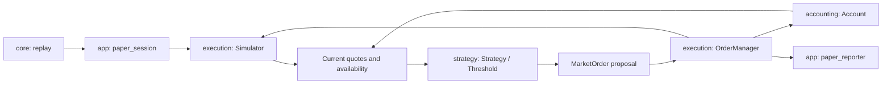

# Automatic strategies in offline paper trading

Run from the repository root with your actual executable path:

```sh
out/build/wsl-live-local/tickforge strategy examples/threshold-market.csv examples/threshold-config.csv
```

In Visual Studio, use a WSL startup item with the same target/working directory as
paper trading and these arguments:

```json
"args": ["strategy", "examples/threshold-market.csv", "examples/threshold-config.csv"]
```

This is a deterministic teaching example. Thresholds are experimental inputs,
not a prediction or evidence of profitability. The command replays a file as fast
as possible; it does not trade on the live network stream. Live capture can produce
the input file for a later experiment. The summary reports realized/unrealized PnL
using the rules in [paper trading](paper-trading.md); the policy itself does not use PnL.

## Components and event order



For each event the app first updates the simulator, then builds a value snapshot
of current bid/ask, availability, event time, and confirmed balances. It invokes
`Strategy::on_market` once and submits at most one proposed market order through
the existing risk/reservation/execution path. It prints the triggering event and
side before the request, fills, fees, and resulting balances. The next decision
sees the confirmed result, including partial fills or rejected requests.

`strategy/strategy.hpp` defines that interface and value snapshot. It has no file,
console, socket, or simulator dependency. `threshold.hpp` and `threshold.cpp`
implement the first policy. `tickforge_strategy` has its own directory and CMake
target and depends only on core types and accounting balances. The application
assembles these components; changing a strategy does not change the ledger.

## Configuration

The configuration reuses the versioned account/risk settings from the
[paper scenario format](paper-trading.md). Instead of scripted `order` rows it has
exactly one fourth row:

```text
tickforge-orders,1,BTCUSDT
account,10000000000,0
config,1000,1000,1000000,1000000,5000000000
threshold,10000,10200,200000,1000000000
```

The threshold fields are `buy_price_atoms,sell_price_atoms,quantity_atoms,buy_budget_quote_atoms`.
Prices are integer hundredths of USDT; BTC quantities and USDT budgets use 1e-8
units. The example means buy when ask <= 100.00 USDT, sell when bid >= 102.00 USDT,
request 0.002 BTC, and spend at most 10 USDT per buy including fees. Buy price must
be positive and below sell price. Quantity must be positive and aligned with the
execution quantity step; budget must be positive. Risk limits still apply.
The `paper` command rejects threshold configurations, and `strategy` rejects
scripted scenarios. Mixing the two kinds of rows is invalid.

When flat, the policy proposes a buy at or below the threshold. When holding BTC,
it proposes a sale at or above the other threshold, capped by the configured lot
and available inventory and rounded down to the quantity step. It does not top up
a partial buy. Inventory below one step remains as dust. Open reservations block
decisions. Missing, stale, invalid, or crossed quotes produce no order.

Decisions are per recorded event, including trades. Rejected or cancelled buys
can be retried on later events with new IDs while the condition holds. Virtual
depth remains depleted until the simulator observes a replenishing level update
or snapshot. There is no cooldown, price slippage limit, or guaranteed execution
price: the threshold triggers a market order, which may cross further depth.
The budget caps buy spending. These assumptions must be considered when comparing
sessions with different event rates or depth coverage.

## Verified synthetic example

The first snapshot offers only 0.001 BTC, so the requested 0.002 BTC buy is partial.
A reset blocks decisions, and a later snapshot allows selling the 0.001 BTC
actually held. The final trade triggers no order. Expected result:

```text
Paper complete | 2 requests | 0 rejected | 2 fills | fees=0.00020200 USDT
  USDT    | total=100.00179800 | reserved=0.00000000 | available=100.00179800
  BTC     | total=0.00000000 | reserved=0.00000000 | available=0.00000000
  PNL     | cost basis=0.00000000 USDT | average cost=unavailable (no BTC) | realized=+0.00179800 USDT
  MARK    | bid 102.00 USDT at event #4 (before exit fees and depth)
  VALUE   | BTC=0.00000000 USDT | equity=100.00179800 USDT
  TOTAL   | realized=+0.00179800 USDT | unrealized=+0.00000000 USDT | total=+0.00179800 USDT
```

Tests verify decisions after partial/rejected execution, invalid data, reserves,
quantity steps, unavailable funds, invalid configuration, and exact deterministic
CLI output on two runs. The strategy receives no future events; the app provides
one snapshot only after the current event has been applied.
