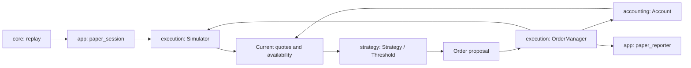

# Automatic strategies in offline paper trading

Run from the repository root with your actual executable path:

```sh
out/build/wsl-live-local/tickforge strategy examples/threshold-market.csv --config examples/threshold.toml
```

In Visual Studio, use a WSL startup item with the same target/working directory as
paper trading and these arguments:

```json
"args": ["strategy", "examples/threshold-market.csv", "--config", "examples/threshold.toml"]
```

This is a deterministic teaching example. Thresholds are experimental inputs,
not a prediction or evidence of profitability. The command replays a file as fast
as possible; it does not trade on the live network stream. Live capture can produce
the input file for a later experiment. The summary reports realized/unrealized PnL
using the rules in [paper trading](paper-trading.md); the policy itself does not use PnL.

## Components and event order



For each event the app first updates the simulator, then builds a value snapshot
of current bid/ask, availability, event time, confirmed balances, and the position
(cost basis and realized PnL). Bid/ask are the best levels still executable for
this account: recorded size minus liquidity consumed by earlier virtual orders. The view
also carries the account risk state (`buys_allowed`, `sells_allowed`, see
[risk limits](paper-trading.md#risk-limits)); the threshold policy proposes no buy in
reduce-only and nothing when halted. The view also lists the account's **open
orders** (in flight or resting) with their filled quantity and whether a cancel was
requested. The app invokes `Strategy::on_market` once per event and carries out the
returned **actions** in order:

| Action | Meaning |
| --- | --- |
| `Place{order, signal}` | submit a market or limit order through the risk/reservation/execution path |
| `Cancel{order_id}` | request a cancel; it may arrive after the order filled |
| `Notice{text}` | explain a decision in the journal (for example a cooldown start) |

The journal prints the triggering event and signal before each request, then fills,
fees, and resulting balances. The next decision sees the confirmed result, including
partial fills, resting orders, or rejected requests.

`strategy/strategy.hpp` defines that interface and value snapshot. It has no file,
console, socket, or simulator dependency. `rules.hpp/.cpp` holds the rules both
policies share: break-even selling with ledger-identical rounding, the stop-loss
trigger, the post-stop cooldown, and the usable-quote check. `threshold.*` implements
the market-order policy and `threshold_maker.*` the limit-order policy. `tickforge_strategy` has its own directory and CMake
target and depends only on core types and accounting balances. The application
assembles these components; changing a strategy does not change the ledger.

## Two policies: `threshold` and `threshold_maker`

`[strategy] type` selects one of two classes with the same configuration keys. They
differ in logic rather than in a parameter, so they are separate classes instead of one
class with a flag; their shared rules live in `rules.*`.

| | `threshold` | `threshold_maker` |
| --- | --- | --- |
| Entry | market buy when ask <= `buy_below` | post-only limit bid at min(`buy_below`, best bid), resting |
| Exit | market sell when bid >= `sell_above` and not at a loss | post-only limit ask at max(`sell_above`, break-even after the maker fee, best bid + 1 tick) |
| Fees | taker on every fill | maker on resting fills |
| Partial entry | the remainder is cancelled at once | a still-resting bid is cancelled once any BTC is held |
| Stop-loss | market sell | cancel the resting ask first (its BTC is reserved), then market sell |
| State | balances only | balances plus its open orders |

The maker never chases: a resting order stays until it fills, the position changes, or
the risk guard cancels it. The bid is never above the best bid and the ask never at or
below it, so post-only never refuses. One tick is one price atom (0.01 USDT, the
BTCUSDT tick). Every fill of the maker waits for real trades to reach it through the
[queue model](paper-trading.md#limit-orders-and-the-queue-model), so the maker fills
less often and at worse moments (adverse selection) than its prices suggest.

Both policies read the account's balances and position, so a run must have exactly one
strategy. Strategy-owned sub-ledgers are planned with multi-strategy accounts.

## Configuration

The [TOML config](paper-trading.md#config-file-toml-version-1) uses the same
`[account]` and `[execution]` tables as scripted experiments. Instead of
`[[orders]]` it has one `[strategy]` table (`examples/threshold.toml`):

```toml
[strategy]
type = "threshold"
buy_below = "100.00"   # buy when the best ask is at or below
sell_above = "102.00"  # sell when the best bid is at or above
quantity = "0.002"     # BTC per request
buy_budget = "10"      # USDT per buy, including fees
stop_loss = "0%"       # optional, default 0% (off)
cooldown = "0s"        # optional, default 0s; requires a stop-loss
```

The example means buy when ask <= 100.00 USDT, sell when bid >= 102.00 USDT,
request 0.002 BTC, and spend at most 10 USDT per buy including fees. Buy price must
be positive and below sell price. Quantity must be positive and aligned with the
execution quantity step; budget must be positive. Risk limits still apply. Any value
can be varied per run, for example `--set strategy.stop_loss=0.2%`. The `paper`
command rejects a `[strategy]` table, and `strategy` requires one.

When flat, the policy proposes a buy at or below the threshold. When holding BTC,
it proposes a sale at or above the other threshold, capped by the configured lot,
available inventory, and the size of the best executable bid, then rounded down to
the quantity step. Capping by the best bid keeps the whole sale at the checked price
instead of slipping to lower levels.

A sale is also proposed only if it does not realize a loss: proceeds after the sale
fee must cover the sold share of the cost basis. With average cost `A` and fee rate
`f`, this means roughly `bid * (1 - f) >= A`. The check uses the same integer
rounding as the simulator and ledger (proceeds down, fee up, sold cost up), so the
decision and the accounting agree on break-even cases. The fee rate is taken from the
`config` row. Without a stop-loss, the consequence is visible in experiments: after a
price drop the policy holds BTC indefinitely.

## Stop-loss

The optional `stop_loss` percentage (`"0%"` or absent disables it) exits a
losing position. When held BTC valued at the best executable bid is at least that
far below its cost basis, the policy sells the position at market:

```text
held BTC * bid <= cost basis * (1 - stop_loss)
```

The limit rounds up, so rounding never delays the stop. The stop takes priority over
the sell threshold and skips the break-even check and the best-bid size cap: it
prefers leaving to waiting, accepting slippage. The configured lot still caps the
request. The journal labels it `STOP-LOSS`. The realized loss is usually larger than
the stop distance: add the exit fee, slippage, and the gap between events.

Two consequences matter when choosing the value:

- The cost basis already includes the buy fee, and a fresh position is valued at the
  bid, below the ask it was bought at. Right after a buy the position is therefore
  "down" by roughly the buy fee plus the spread. A stop narrower than that fires
  immediately after every purchase.
- Without a cooldown, the policy is flat after a stop and buys again on the next
  event while ask <= the buy threshold. A stop close to the entry price turns a
  sideways market into repeated buy/stop round trips, each paying two fees.

On a private 15-minute BTCUSDT recording with 0.1% fees, a 0.1% stop without a
cooldown produced dozens of such round trips and lost tens of USDT on a 0.01 BTC lot,
while a 0.2% stop triggered rarely. Recordings are not in Git; the effect is
reproduced by the synthetic CLI test, where the policy stops out and immediately rebuys.

## Cooldown after a stop-loss

The optional `cooldown` duration pauses new **buys** after a stop-loss
exit. It requires a stop-loss; a cooldown without one is rejected because it would
silently do nothing. Design choices:

- **Recorded time, not event count.** Event rates follow market activity: a fast
  market would make an event-count pause shortest exactly when it matters most. The
  pause uses `receive_elapsed_ns`, the recorded monotonic offset, so replay remains
  deterministic. Exchange timestamps are missing for snapshots and need not increase;
  the computer's current clock has no relation to a replayed session.
- **Only after a stop-loss.** After a take-profit sale `ask > bid >= sell threshold >
  buy threshold`, so an immediate rebuy is impossible anyway.
- **Only buys wait.** Stops and take-profit sales are never delayed: blocking a stop
  would defeat its purpose.
- **Started by confirmed balances.** Proposing a stop starts nothing: the order may be
  rejected or fill partially, and the stop then retries. The pause starts at the
  first event whose view shows no BTC after a stop proposal, even if quotes are
  unavailable at that moment. Otherwise a long series of rejected stops could use up
  the pause before the exit actually happened. Because the view follows the event
  that executed the stop, the pause starts one event after the fill.

The journal prints `Cooldown | event #N | ... no buys until elapsed=T ns`. On the same
private recordings, a 30 or 120 second cooldown cut the 0.1% stop's round trips
several times and reduced its loss accordingly. The results remained negative: the
cooldown limits repeated entries but cannot make a stop narrower than fee plus spread
useful. It does not top up
a partial buy. Inventory below one step remains as dust. Open reservations block
decisions. Missing, stale, invalid, or crossed quotes produce no order.

Decisions are per recorded event, including trades. Rejected or cancelled buys
can be retried on later events with new IDs while the condition holds. Virtual
depth remains depleted until the simulator observes a replenishing level update
or snapshot. There is no cooldown, price slippage limit, or guaranteed execution
price: the threshold triggers a market order, which may cross further depth.
The budget caps buy spending. These assumptions must be considered when comparing
sessions with different event rates or depth coverage.

## Verified synthetic example

The first snapshot offers only 0.001 BTC, so the requested 0.002 BTC buy is partial.
A reset blocks decisions, and a later snapshot allows selling the 0.001 BTC
actually held. The final trade triggers no order. Expected result:

```text
Paper complete | 2 requests | 0 rejected | 2 fills | fees=0.00020200 USDT
  USDT    | total=100.00179800 | reserved=0.00000000 | available=100.00179800
  BTC     | total=0.00000000 | reserved=0.00000000 | available=0.00000000
  PNL     | cost basis=0.00000000 USDT | average cost=unavailable (no BTC) | realized=+0.00179800 USDT
  MARK    | bid 102.00 USDT at event #4 (before exit fees and depth)
  VALUE   | BTC=0.00000000 USDT | equity=100.00179800 USDT
  TOTAL   | realized=+0.00179800 USDT | unrealized=+0.00000000 USDT | total=+0.00179800 USDT
```

Tests verify break-even selling, stop-loss triggering and priority, decisions after
partial/rejected execution, invalid data, reserves, quantity steps, unavailable
funds, invalid configuration, and exact deterministic
CLI output on two runs. The strategy receives no future events; the app provides
one snapshot only after the current event has been applied.
